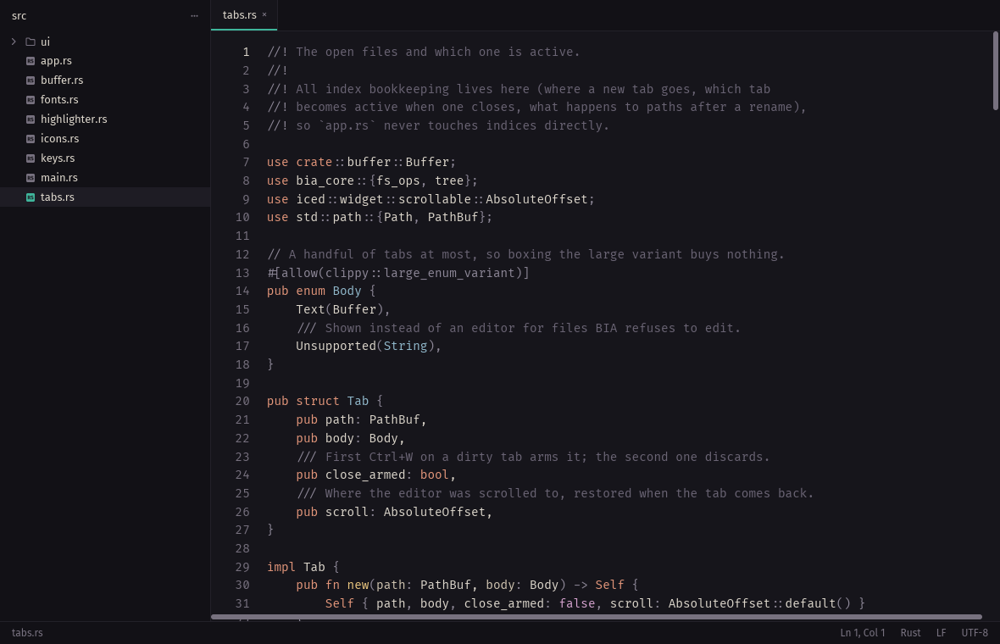

<div align="center">
  
  <p>A happy minimalist editor.</p>
  <p><a href="README.pt-BR.md">Português</a> · <a href="docs/ARCHITECTURE.md">Architecture</a> · <a href="CONTRIBUTING.md">Contributing</a></p>
  <p>
    <a href="https://github.com/thdtr/bia/actions/workflows/ci.yml"></a>
    <a href="https://github.com/thdtr/bia/releases/latest"></a>
    <a href="#license"></a>
  </p>
</div>

BIA is a small code editor for Linux, macOS and Windows, written in Rust. File tree,
syntax highlighting, Markdown preview, themes and one settings file. That's it.



## Install

Linux and macOS:

```sh
curl -fsSL https://raw.githubusercontent.com/thdtr/bia/main/install.sh | sh
```

Windows (PowerShell):

```powershell
irm https://raw.githubusercontent.com/thdtr/bia/main/install.ps1 | iex
```

No admin rights needed. Open BIA from your app menu, or run `bia ~/code/project`.
`bia src/main.rs:42` opens a file at line 42. Run with no arguments, BIA reopens the
last folder you opened.

You can also grab a build from [releases](https://github.com/thdtr/bia/releases) or run
`cargo install --git https://github.com/thdtr/bia bia`. To uninstall, add `--uninstall`
(`... | sh -s -- --uninstall`). On Windows, set `$env:BIA_UNINSTALL=1` and run the
install command again.

### Warning on first launch

BIA builds aren't signed with a paid certificate. If you download one from the
releases page, your system may warn you the first time you open it:

- **Windows:** click *More info*, then *Run anyway*.
- **macOS:** go to *System Settings → Privacy & Security* and click *Open Anyway*.

The install commands above don't trigger this warning.

## Features

- File tree with one folder per line
- Highlighting for ~200 languages, plus any `.sublime-syntax` file you add ([how](docs/LANGUAGES.md))
- Line numbers, tabs, find and replace, undo and redo
- Open a file by name, go to a line
- Indentation that follows each file: tabs or spaces, and how many
- Live Markdown preview
- Dark and light themes, or your own in JSON ([how](docs/THEMES.md))
- English and Portuguese
- Safe saves: atomic writes, line endings kept, deleted files go to the trash

## No network code

BIA never connects to the internet. There's no telemetry and no update check, and CI
fails if network code ever gets into the project ([details](docs/SEALED.md)).

## Shortcuts

| Keys | Action |
|---|---|
| `Ctrl+O` | Open folder |
| `Ctrl+S` | Save |
| `Ctrl+W` | Close tab |
| `Ctrl+P` | Open file by name |
| `Ctrl+G` | Go to line |
| `Ctrl+F` / `F3` | Find / next match |
| `Ctrl+H` | Replace |
| `Ctrl+Z` / `Ctrl+Shift+Z` | Undo / redo |
| `Ctrl+Shift+V` | Markdown preview |
| `Ctrl+B` | Toggle sidebar |
| `Ctrl+N` / `Ctrl+Shift+N` | New file / folder |
| `F2` / `Delete` | Rename / move to trash |
| `Ctrl+,` | Settings |

On a Mac, use `Cmd`. Replace is `Cmd+Alt+F`.

## Settings

`Ctrl+,` opens `settings.json`. Changes apply when you save.

```json
{
  "font_family": "Fira Code",
  "font_size": 14,
  "line_height": 1.55,
  "tab_size": 4,
  "ui_font_family": "Fira Sans",
  "ui_font_size": 13,
  "theme": "noite",
  "language": "auto",
  "hidden": [".git", "node_modules", "target"]
}
```

`font_*` is for the editor and `ui_font_*` for the interface. BIA ships with Fira Sans
and Fira Code, but any installed font works.
`theme` is `noite`, `dia` or one of yours. `language` is `auto`, `en` or `pt-BR`.
`hidden` lists names the file tree skips.
`tab_size` is the indent width for files with no indentation yet. Files that have
some keep their own.

## License

MIT or Apache 2.0, your choice. The bundled Fira fonts are under the
[SIL Open Font License](assets/fonts/OFL-FiraSans.txt).
