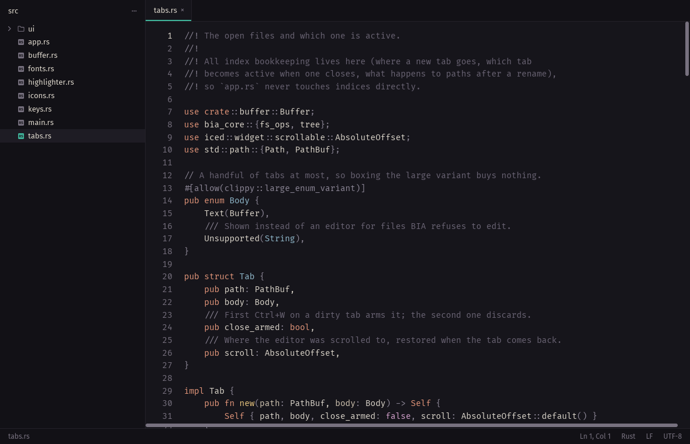

<div align="center">
  
  <p>Um editor minimalista feliz.</p>
  <p><a href="README.md">English</a> · <a href="docs/ARCHITECTURE.md">Arquitetura</a> · <a href="CONTRIBUTING.md">Como contribuir</a></p>
  <p>
    <a href="https://github.com/thdtr/bia/actions/workflows/ci.yml"></a>
    <a href="https://github.com/thdtr/bia/releases/latest"></a>
    <a href="#licença"></a>
  </p>
</div>

O BIA é um editor de código pequeno para Linux, macOS e Windows, feito em Rust.
Árvore de arquivos, destaque de sintaxe, prévia de Markdown, temas e um arquivo de
configuração. Só isso.



## Instalação

Linux e macOS:

```sh
curl -fsSL https://raw.githubusercontent.com/thdtr/bia/main/install.sh | sh
```

Windows (PowerShell):

```powershell
irm https://raw.githubusercontent.com/thdtr/bia/main/install.ps1 | iex
```

Não precisa de administrador. Abra o BIA pelo menu de aplicativos ou rode
`bia ~/codigo/projeto`. `bia src/main.rs:42` abre o arquivo na linha 42. Sem
argumentos, o BIA reabre a última pasta que você abriu.

Também dá para baixar pela página de [releases](https://github.com/thdtr/bia/releases)
ou rodar `cargo install --git https://github.com/thdtr/bia bia`. Para desinstalar,
adicione `--uninstall` (`... | sh -s -- --uninstall`). No Windows, defina
`$env:BIA_UNINSTALL=1` e rode o comando de instalação de novo.

Para atualizar, rode o comando de instalação de novo. Suas configurações continuam
como estão.

### Aviso na primeira vez

Os binários do BIA não são assinados com certificado pago. Se você baixar pela página
de releases, o sistema pode mostrar um aviso na primeira vez que abrir o BIA:

- **Windows:** clique em *Mais informações* e depois em *Executar assim mesmo*.
- **macOS:** vá em *Ajustes do Sistema → Privacidade e Segurança* e clique em *Abrir Mesmo Assim*.

Com os comandos de instalação acima, esse aviso não aparece.

## Recursos

- Árvore de arquivos com uma pasta por linha. Crie, renomeie, mova, copie e mande para a lixeira ali mesmo, com o botão direito ou arrastando
- Destaque de sintaxe para umas 200 linguagens, e outras com um arquivo `.sublime-syntax` ([veja como](docs/LANGUAGES.md))
- Números de linha, abas, desfazer e refazer
- Um menu, todos os comandos pelo nome (`Ctrl+Shift+P`) e uma janela Sobre
- Arquivos novos guardados até você salvar, mesmo se sair
- Histórico local, com as últimas 30 versões salvas de cada arquivo para trazer de volta
- Réguas, guias de indentação, espaços visíveis e destaque de `TODO` nos comentários
- Segue o `.editorconfig` do projeto
- Atalhos que você muda no `settings.json`
- Buscar e substituir, com maiúsculas, palavra inteira e regex
- Busca em todos os arquivos, pulando o que está no `.gitignore`
- Abrir arquivo pelo nome, ir para uma linha
- Vários cursores, em todos os comandos
- Comentar, mover, duplicar e apagar linhas; parênteses e aspas fecham sozinhos
- Arquivos de qualquer tamanho abrem na hora, com número de linha
- Indentação que segue cada arquivo: tabs ou espaços, e quantos
- Prévia de Markdown ao vivo, numa aba própria
- Dois arquivos lado a lado
- Temas claro e escuro, ou o seu em JSON ([veja como](docs/THEMES.md))
- Português e inglês
- Salvamento seguro: gravação atômica, quebras de linha mantidas, arquivo apagado vai para a lixeira
- Reabre os arquivos que estavam abertos e recupera o que não foi salvo depois de um travamento
- Git: linhas alteradas ao lado dos números, arquivos alterados na árvore, a branch
- Terminais abaixo do editor, em abas. Ctrl+clique em `arquivo:linha` abre o arquivo
- Servidores de linguagem que você escolhe: erros enquanto digita, completar, ir para
  a definição, hover, formatar, renomear

## Sem código de rede

O BIA nunca se conecta à internet. Não tem telemetria nem busca por atualização, e o
CI falha se algum código de rede entrar no projeto ([detalhes](docs/SEALED.md)).

## Atalhos

| Teclas | Ação |
|---|---|
| `Ctrl+O` | Abrir pasta |
| `Ctrl+S` | Salvar |
| `Ctrl+W` | Fechar aba |
| `Ctrl+P` | Abrir arquivo pelo nome |
| `Ctrl+G` | Ir para linha |
| `Alt+←` / `Alt+→` | Voltar / avançar |
| `Ctrl+F` / `F3` | Buscar / próximo resultado |
| `Ctrl+H` | Substituir |
| `Ctrl+Shift+F` | Buscar nos arquivos |
| `Ctrl+/` | Comentar ou descomentar linhas |
| `Alt+↑` / `Alt+↓` | Mover linhas |
| `Shift+Alt+↑` / `Shift+Alt+↓` | Duplicar linhas |
| `Ctrl+Shift+K` | Apagar linhas |
| `Ctrl+L` | Selecionar linha (de novo para a próxima) |
| `Ctrl+D` | Selecionar a próxima ocorrência (mais um cursor) |
| `Ctrl+Shift+L` | Selecionar todas as ocorrências |
| `Ctrl+Alt+↑` / `Ctrl+Alt+↓` | Cursor a mais acima / abaixo |
| `Alt+clique` | Pôr ou tirar um cursor |
| `F12` / `Ctrl+clique` | Ir para a definição (servidor de linguagem) |
| `Ctrl+Space` | Completar (servidor de linguagem) |
| `Shift+Alt+F` | Formatar o arquivo (servidor de linguagem) |
| `F2` no editor | Renomear o símbolo (servidor de linguagem) |
| `F8` / `Shift+F8` | Próximo / anterior problema |
| `Ctrl+Z` / `Ctrl+Shift+Z` | Desfazer / refazer |
| `Ctrl+Shift+V` | Prévia de Markdown |
| `Ctrl+B` | Mostrar ou esconder a barra lateral |
| `Ctrl+N` / `Ctrl+Shift+N` | Novo arquivo / nova janela |
| `Ctrl+Shift+S` | Salvar como |
| `Ctrl+Shift+T` | Reabrir a aba fechada |
| `Ctrl+Shift+P` | Todos os comandos |
| `Ctrl+Q` | Sair |
| `F2` / `Delete` | Renomear / mandar para a lixeira |
| `Ctrl+=` / `Ctrl+-` / `Ctrl+0` | Fonte maior / menor / original |
| `` Ctrl+` `` | Mostrar / esconder o terminal |
| `` Ctrl+Shift+` `` | Novo terminal |
| `Ctrl+\` | Levar a aba para o outro lado |
| `Ctrl+,` | Configurações |

No Mac, use `Cmd` e `Option`. Substituir é `Cmd+Alt+F`. `Ctrl+Space` e ``Ctrl+` `` continuam com `Ctrl`, porque o macOS usa `Cmd` nesses dois.

## Configurações

`Ctrl+,` abre o `settings.json`. As mudanças valem quando você salva.

```json
{
  "font_family": "Fira Code",
  "font_size": 14,
  "line_height": 1.55,
  "tab_size": 4,
  "ui_font_family": "Fira Sans",
  "ui_font_size": 13,
  "theme": "noite",
  "language": "auto",
  "hidden": [".git", "node_modules", "target"],
  "auto_close": true,
  "soft_wrap": false
}
```

`font_*` vale para o editor e `ui_font_*` para a interface. O BIA já vem com as
fontes Fira Sans e Fira Code, mas aceita qualquer fonte instalada. `theme` pode ser
`noite`, `dia` ou um tema seu. `language` pode ser `auto`, `en` ou `pt-BR`. `hidden` lista os nomes que a árvore não mostra.
`auto_close` fecha parênteses, colchetes, chaves e aspas por você.
`soft_wrap` quebra as linhas longas na borda da janela (`"edge"`) ou com `wrap_column`
caracteres (`"column"`). Tem mais, como réguas, espaços visíveis, salvar sozinho, tirar espaços ao
salvar e configurações por linguagem. Veja a
[referência de configurações](site/content/docs/settings.pt-br.md). O BIA também segue
o `.editorconfig` do projeto.

Para usar um servidor de linguagem, informe o programa de cada linguagem, com o nome
que aparece na barra de status. O BIA não inicia nenhum sozinho:

```json
"language_servers": {
  "Rust": ["rust-analyzer"],
  "Python": ["pyright-langserver", "--stdio"]
}
```
`tab_size` é a largura de um tab na tela e a da indentação em arquivos que ainda não
têm nenhuma. Os que já têm mantêm a deles.

## Licença

[MIT](LICENSE). As fontes Fira que vêm junto usam a
[SIL Open Font License](assets/fonts/OFL-FiraSans.txt).
